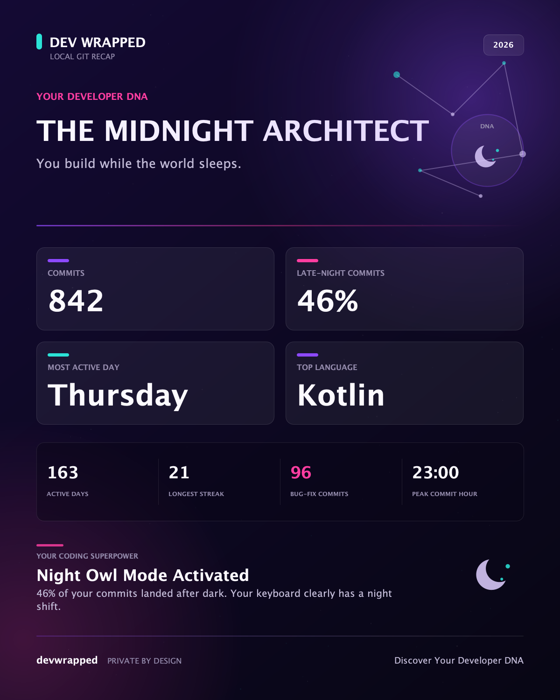

# Dev Wrapped

**Discover Your Developer DNA.**

[](https://github.com/msuranek/dev-wrapped/actions/workflows/build.yml)

**Marketplace Beta:** [Dev Wrapped 0.1.2 on JetBrains Marketplace](https://plugins.jetbrains.com/plugin/35069-dev-wrapped)

## Your Git history has a personality. Discover yours.

Dev Wrapped is a free, open-source JetBrains IDE plugin that transforms your local Git history into a beautiful, shareable developer personality card.

Everything happens on your computer: no account, backend, telemetry, AI API, or repository upload.

## Preview



_Example Developer DNA card generated by the production renderer with fictional sample data._

## Why Dev Wrapped?

Git histories contain patterns: late-night commits, steady streaks, fix-heavy sessions, weekend activity, and work across different languages. Dev Wrapped turns those patterns into a playful **Developer DNA** archetype such as **The Midnight Architect**, **The Commit Machine**, or **The Bug Whisperer**.

It is a fun summary of commit activity—not a score, performance review, or measurement of developer ability.

## Features

- **Six deterministic archetypes:** The Midnight Architect, The Weekend Warrior, The Bug Whisperer, The Commit Machine, The Polyglot, and The Steady Builder.
- **Local Git analysis:** select an exact Git identity and analyze commits reachable from the current repository.
- **Useful activity signals:** commits, active days, longest streak, peak day and hour, late-night activity, fix-like commits, and file-based language activity.
- **Clear reporting periods:** Last 30 days, This year, or All time.
- **Share-ready output:** a fixed 1200 × 1500 share card with a proportionally scaled IDE preview.
- **Simple sharing:** save the full-resolution card as PNG or copy it directly as an image.
- **Privacy by default:** cards contain anonymous aggregate statistics, not identity or repository details.

## Installation

Dev Wrapped 0.1.2 is an approved JetBrains Marketplace beta. The plugin is currently hidden from regular Marketplace search, so use the direct link or add its Beta repository.

### Install the Marketplace beta

1. Open the [Dev Wrapped Marketplace page](https://plugins.jetbrains.com/plugin/35069-dev-wrapped).
2. In your JetBrains IDE, open **Settings → Plugins**, select the gear menu, and choose **Manage Plugin Repositories…**.
3. Add the [Dev Wrapped Beta repository](https://plugins.jetbrains.com/plugins/beta/35069):

   ```text
   https://plugins.jetbrains.com/plugins/beta/35069
   ```

4. Return to the **Marketplace** tab, search for **Dev Wrapped**, and click **Install**.
5. Restart the IDE if prompted.

### Build and install from source

1. Clone or download the source from the intended repository: [github.com/msuranek/dev-wrapped](https://github.com/msuranek/dev-wrapped).
2. Install JDK 21 and Git.
3. Build the plugin:

   ```bash
   ./gradlew buildPlugin
   ```

4. Find the generated ZIP under `build/distributions/`.
5. In your JetBrains IDE, open **Settings → Plugins**, select the gear menu, choose **Install Plugin from Disk…**, and select the ZIP.
6. Restart the IDE when prompted.

The plugin descriptor requires IntelliJ Platform build **252 (2025.2)** or later. Plugin Verifier has reported compatibility with IntelliJ IDEA Community 2025.2.4 and PhpStorm 2025.3.2. Marketplace installation and the core analysis-to-card flow have been manually tested in PhpStorm 2025.3.2 on macOS. Manual IntelliJ IDEA testing remains outstanding.

## Usage

1. Open a Git-backed project.
2. Choose **Tools → Dev Wrapped → Generate My Dev Wrapped**.
3. Select a Git identity and reporting period.
4. Click **Generate My Dev Wrapped**.
5. Review the Developer DNA share card.
6. Choose **Save PNG…**, **Copy Image**, or **Close**.

Identity commit counts update when the reporting period changes. Dev Wrapped prefers the configured Git author when that identity is active in the period; otherwise, it selects the most recently active identity. Manual selections are preserved while switching periods.

## Privacy

Dev Wrapped is designed to operate locally:

- Git analysis and image rendering run on your computer.
- No account or registration is required.
- No backend service is used.
- No telemetry or analytics tracking is collected.
- No AI or external analysis API is called.
- Source code, commit messages, Git identities, paths, repository names, and remote URLs are not uploaded.
- Share cards contain only the archetype and anonymous aggregate statistics.
- Nothing is posted or shared automatically.

## Development

Requirements:

- JDK 21
- Git available on `PATH`
- No separately installed Gradle distribution—the checked-in wrapper is used

Common commands:

```bash
./gradlew test
./gradlew buildPlugin
./gradlew verifyPluginProjectConfiguration
./gradlew runIde
```

`./gradlew verifyPlugin` checks the current IntelliJ IDEA target without downloading another IDE. To include an existing PhpStorm installation, set `PHPSTORM_HOME` to that installation before running the task. The full release process is documented in [docs/RELEASING.md](docs/RELEASING.md).

## Architecture

- `com.devwrapped.core` — platform-independent models, Git analytics, language detection, and deterministic classification.
- `com.devwrapped.render` — platform-independent Java2D share-card rendering.
- `com.devwrapped.plugin` — IntelliJ actions, dialogs, background progress, clipboard integration, and PNG export.

## Limitations

- Git commit activity is not programming time, productivity, impact, or skill.
- Commit timestamps use the Git **author date**, not the committer date. Dates and hours are interpreted in the IDE machine's current timezone.
- **Last 30 days** is a rolling 30 × 24-hour window. **This year** begins January 1 in the current timezone.
- Analysis runs against the open project's root repository; selecting nested repositories or scanning multiple repositories is not supported.
- The system `git` executable must be installed and available on `PATH`.
- History is traversed with `git log --all --no-merges`. A commit reachable from multiple branches is counted once, and merge commits are excluded.
- Git identities are exact name-and-email pairs. Aliases are not merged automatically.
- Fix-like commits are inferred from common keywords in commit subjects and may be imperfect.
- Language activity is inferred from recognized changed-file paths, not lines of code. Common generated, vendored, and binary paths are excluded where practical.
- Very low activity does not receive an unsupported archetype.

## Contributing

Dev Wrapped is at an early stage, and focused contributions are welcome. Before opening a pull request, run the tests, keep the privacy-first design intact, and avoid expanding the plugin into productivity scoring or remote data collection. Issues and pull requests belong in the intended [GitHub repository](https://github.com/msuranek/dev-wrapped).

Beta feedback is especially useful. The [beta testing guide](docs/BETA_TESTING.md) contains a focused smoke-test checklist and privacy-safe reporting instructions. Report problems through the [GitHub issue tracker](https://github.com/msuranek/dev-wrapped/issues).

## License

Dev Wrapped is available under the [MIT License](LICENSE).
